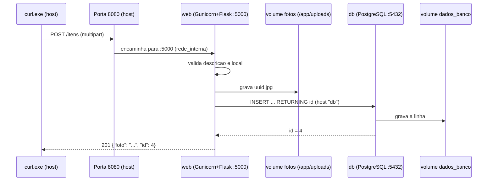

# Relatório técnico: Achados & Perdidos

Ambiente: Docker Desktop no Windows, Docker Compose 5.4.0, PowerShell. As evidências citadas estão em `docs/evidencias/`.

## (a) Dockerfile (`app/Dockerfile`)

| Instrução | O que faz | Por que está nessa posição |
| --- | --- | --- |
| `FROM python:3.12-slim` | Imagem oficial do Python 3.12, variante enxuta (sem compiladores e documentação) | Primeira instrução: define a base. Menor imagem e menos superfície de ataque. O `psycopg[binary]` já vem compilado, então não precisa de compilador |
| `ENV PYTHONDONTWRITEBYTECODE=1 PYTHONUNBUFFERED=1` | Não gera `.pyc`; envia logs sem buffer | Vale para todas as camadas seguintes. Faz os logs aparecerem na hora em `docker compose logs` |
| `WORKDIR /app` | Cria e define o diretório de trabalho | Antes dos `COPY`, que usam caminhos relativos a ele |
| `COPY requirements.txt .` | Copia só a lista de dependências | **Antes do código**, para aproveitar o cache de camadas |
| `RUN pip install --no-cache-dir -r requirements.txt` | Instala Flask, psycopg e Gunicorn sem guardar o cache do pip | Só é reexecutada se o `requirements.txt` mudar. `--no-cache-dir` evita peso inútil na imagem |
| `RUN useradd ... && mkdir -p /app/uploads && chown -R appuser:appuser /app/uploads` | Cria o usuário `appuser` sem privilégios, cria a pasta de uploads e a entrega a ele | Precisa de root, então vem **antes** do `USER`. Quando o volume `fotos` (vazio) é montado em `/app/uploads`, herda esse dono e essas permissões, e o app consegue gravar |
| `COPY app.py .` | Copia o código da aplicação | **Por último**, por ser o que mais muda |
| `USER appuser` | A partir daqui, tudo roda sem root (RNF04) | Depois de tudo que exige privilégio |
| `EXPOSE 5000` | Documenta a porta da aplicação | Não publica nada; quem publica é o `ports:` do Compose |
| `CMD ["gunicorn", "--bind", "0.0.0.0:5000", "--access-logfile", "-", "app:app"]` | Inicia o servidor de produção, escutando em todas as interfaces, com log de acesso na saída padrão | Forma *exec* (colchetes): o Gunicorn é o PID 1 e recebe `SIGTERM` direto do `docker stop`. `0.0.0.0` é obrigatório: em `127.0.0.1` a porta publicada não funcionaria. `app:app` = arquivo `app.py`, variável `app` |

**Ordem escolhida:** do que muda menos para o que muda mais (base, dependências, código). Assim, quando só o `app.py` muda, o Docker reaproveita as camadas do `pip install` e refaz apenas a última.

**`app/.dockerignore`:** impede que `.env`, `__pycache__/` e `*.pyc` entrem no contexto de build, evitando vazar segredos e invalidar o cache por arquivos irrelevantes.

**Resultado:** o usuário do processo é `appuser` (`11-whoami.txt`). A imagem `achados-perdidos-web` aparece em `10-image-ls.txt`; o tamanho citado é o da coluna *DISK USAGE* (206 MB), que inclui as camadas descomprimidas. O *CONTENT SIZE* (50,4 MB) considera o conteúdo comprimido.

## (b) docker-compose.yml

| Bloco | O que faz e por quê |
| --- | --- |
| `services.db.image: postgres:16-alpine` | Imagem oficial do PostgreSQL, em variante Alpine (pequena) |
| `db.environment` (`POSTGRES_DB`, `POSTGRES_USER`, `POSTGRES_PASSWORD`) | Nomes exigidos pela imagem para criar o banco e o usuário na primeira execução. Os valores vêm de `${DB_NAME}`, `${DB_USER}`, `${DB_PASSWORD}`, que o Compose lê do `.env`. Assim nenhuma senha fica no YAML (RNF03) |
| `db.volumes: dados_banco:/var/lib/postgresql/data` | Volume nomeado no diretório de dados do PostgreSQL. É o que faz os dados sobreviverem à recriação do contêiner (RNF02) |
| `db.volumes: ./db/init.sql:/docker-entrypoint-initdb.d/init.sql:ro` | *Bind mount* somente leitura. A imagem executa os `.sql` dessa pasta **apenas quando o diretório de dados está vazio**, criando a tabela `itens` e os três itens de exemplo |
| `db.healthcheck` (`pg_isready -h 127.0.0.1 ...`) | Informa quando o banco realmente aceita conexões. O `$$` é o escape do Compose: o `$` chega literal e quem expande a variável é o shell dentro do contêiner. O `-h 127.0.0.1` força o teste por TCP, evitando um falso "pronto" durante o servidor temporário que a imagem sobe para rodar o `init.sql` |
| `services.web.build: ./app` | Constrói a imagem própria a partir do Dockerfile da pasta `app` |
| `web.environment` | Entrega ao `app.py` as variáveis que ele lê: `DB_HOST=db` (nome do serviço, resolvido pelo DNS interno), `DB_PORT`, `DB_NAME`, `DB_USER`, `DB_PASSWORD` (do `.env`) e `UPLOAD_DIR=/app/uploads` |
| `web.ports: "8080:5000"` | Formato `host:contêiner`. É a **única** porta publicada. O `db` não tem `ports`, então fica isolado na rede interna |
| `web.volumes: fotos:/app/uploads` | Volume nomeado onde o app grava as fotos |
| `web.depends_on: db: condition: service_healthy` | O web só inicia depois que o healthcheck do db passar (RNF05). Sem a `condition`, só se garante a ordem de início dos contêineres, não que o banco esteja pronto |
| `networks: rede_interna` (driver `bridge`) | Rede definida pelo usuário, compartilhada pelos dois serviços. Ativa o DNS interno do Docker: o web encontra o db pelo nome |
| `restart: unless-stopped` | Reinicia o contêiner se cair ou se o Docker reiniciar, exceto se tiver sido parado manualmente |
| `volumes: dados_banco, fotos` | Declara os dois volumes nomeados. O Compose os cria com o prefixo do projeto (`achados-perdidos_dados_banco`, `achados-perdidos_fotos`) |

**Configuração:** `.env.example` e `.env` têm as mesmas chaves (`DB_NAME`, `DB_USER`, `DB_PASSWORD`). Só o `.env.example` vai para o repositório; o `.gitignore` ignora o `.env`.

**Evidências:** `01-compose-ps.txt` mostra o `db` como *healthy* com `5432/tcp` **sem** mapeamento no host, e o web com `0.0.0.0:8080->5000/tcp`. `09-network-inspect.txt` mostra os dois contêineres na `rede_interna` (172.19.0.2 e 172.19.0.3).

## (c) Caminho de `POST /itens` com foto

Comando usado (`05-post.txt` guarda a resposta; a imagem `oculos.jpg` está em `docs/evidencias/`):

```powershell
curl.exe -F descricao="Oculos de grau" -F local="Bloco B" -F "foto=@docs/evidencias/oculos.jpg" http://localhost:8080/itens
```

1. O `curl.exe` envia uma requisição `multipart/form-data` para `localhost:8080` no host.
2. O Docker, que publicou `8080:5000`, encaminha a conexão para a porta 5000 do contêiner `web`, dentro da `rede_interna`.
3. O Gunicorn (PID 1 do contêiner, rodando como `appuser`) recebe a requisição e a entrega ao Flask.
4. A função `cadastrar()` lê `descricao` e `local`. Se faltar algum, responde `400`.
5. Se há arquivo `foto`, o app gera um nome `uuid4().hex` + extensão e grava em `/app/uploads`, que é o volume `fotos` (fisicamente em `/var/lib/docker/volumes/achados-perdidos_fotos/_data`, dentro da VM do Docker Desktop).
6. O psycopg conecta em `host=db port=5432`. O nome `db` é resolvido pelo DNS interno do Docker (127.0.0.11) para o IP do contêiner do banco (172.19.0.2).
7. O PostgreSQL executa `INSERT INTO itens ... RETURNING id` e grava em `/var/lib/postgresql/data`, que é o volume `dados_banco`.
8. O app responde `201` com `{"foto": "<nome>.jpg", "id": 4}`, que o `curl.exe` mostra.

Diagrama de sequência (Mermaid):



## (d) Ciclo de vida dos volumes

Os horários da primeira coluna são do Windows (UTC-3). O `criado_em` dos itens vem do banco, em UTC; a diferença de 3 horas é só fuso horário.

**Nota sobre os logs:** os itens 4 e 5 foram cadastrados (21:08 e 21:13 UTC) antes de o contêiner `web` atual ser criado: o log em `07-logs.txt` começa às 22:09 UTC e a rede foi criada às 21:57 UTC (`09-network-inspect.txt`). Por isso o log não mostra o POST. Os dados continuaram disponíveis porque estão nos volumes, que sobrevivem à recriação dos contêineres.

### Inspeção dos volumes

- `15-volume-ls.txt`: lista os volumes, incluindo os dois do projeto (`achados-perdidos_dados_banco` e `achados-perdidos_fotos`). Os demais são de outros projetos.
- `15-volume-inspect-dados_banco.txt` e `15-volume-inspect-fotos.txt`: `Driver: local` e `Mountpoint` em `/var/lib/docker/volumes/achados-perdidos_<volume>/_data`, com `CreatedAt: 2026-10-19T20:52:25Z`. Os dados ficam fisicamente **na máquina onde roda o daemon do Docker**. No Docker Desktop isso é dentro da VM Linux, e não numa pasta do Windows.
- `15-ls-uploads.txt`: as fotos pertencem a `appuser`, efeito do `chown` do Dockerfile.

### Teste 1: `docker compose down` + `up -d`

| Item | Antes (`12-antes-down.txt`) | Depois (`14-depois-up.txt`) | Resultado |
| --- | --- | --- | --- |
| Horário (local) | 19:15:12 | 19:18:12 | Sequência correta |
| Container web (`/health`) | `02a470f552fc` | `eab6f31a672a` | Mudou: foi recriado |
| `itens_no_banco` | 5 | 5 | Igual |
| `fotos_no_volume` | 2 | 2 | Igual |
| Foto 1 | `6194647f...jpg`, 5825 bytes | `6194647f...jpg`, 5825 bytes | Igual |
| Foto 2 | `c86adca0...jpg`, 85322 bytes | `c86adca0...jpg`, 85322 bytes | Igual |
| `criado_em` dos itens | 21:13:53 / 21:08:11 / 20:52:29 | 21:13:53 / 21:08:11 / 20:52:29 | Iguais: são as mesmas linhas |

A saída dos comandos está em `13-down-up.txt`. As fotos também foram abertas no navegador antes e depois (`12b-foto-antes-down.png` e `14b-foto-apos-recriar.png`), com a mesma URL.

### Teste 2: `docker compose down -v` + `up -d`

| Item | Antes (`16-antes-down-v.txt`) | Depois (`18-depois-down-v.txt`) |
| --- | --- | --- |
| Container web | `eab6f31a672a` | `e0e76d25bcba` |
| `itens_no_banco` | 5 | **3** |
| `fotos_no_volume` | 2 | **0** |
| `criado_em` dos itens de exemplo | 20:52:29 | **22:20:51** |
| `ls -l /app/uploads` | 2 arquivos | `total 0` |
| `GET /fotos/6194647f...jpg` | abre | **HTTP 404** (`18b-foto-apos-down-v.txt`) |

`17-down-v.txt` guarda a saída do `down -v` e do `up -d` seguinte. `17b-volume-ls-apos-down-v.txt` mostra que os volumes não existiam entre o `down -v` e o `up`, e `18c-volume-inspect-fotos-recriado.txt` mostra o volume `fotos` recriado.

### Resumo dos três momentos

| Momento | itens\_no\_banco | fotos\_no\_volume | Evidência |
| --- | --- | --- | --- |
| Antes do `down` | 5 | 2 | `12-antes-down.txt` |
| Depois de `down` + `up -d` | 5 | 2 | `14-depois-up.txt` |
| Depois de `down -v` + `up -d` | 3 | 0 | `18-depois-down-v.txt` |

### Explicação

O `docker compose down` remove contêineres e rede, mas **não** remove volumes nomeados. Como os dados estavam em `dados_banco` e `fotos`, e não na camada gravável dos contêineres, eles sobreviveram à recriação: o ID do contêiner mudou, e os itens, as fotos, os tamanhos e os `criado_em` permaneceram idênticos.

O `docker compose down -v` remove também os volumes. Na subida seguinte, o volume `dados_banco` estava vazio, e a imagem do PostgreSQL trata esse caso como primeira execução: roda o `init.sql` de novo. Por isso voltaram apenas os três itens de exemplo, com `criado_em` novo (22:20:51). O volume `fotos` foi recriado vazio, e a foto antiga passou a retornar 404. Os dois itens cadastrados por mim e as duas fotos foram perdidos.

**Conclusão:** o ciclo de vida dos dados é independente do ciclo de vida dos contêineres. `down` preserva, `down -v` destrói. Em nuvem, o equivalente é o banco gerenciado e o armazenamento de objetos, que também sobrevivem à troca das instâncias da aplicação.
