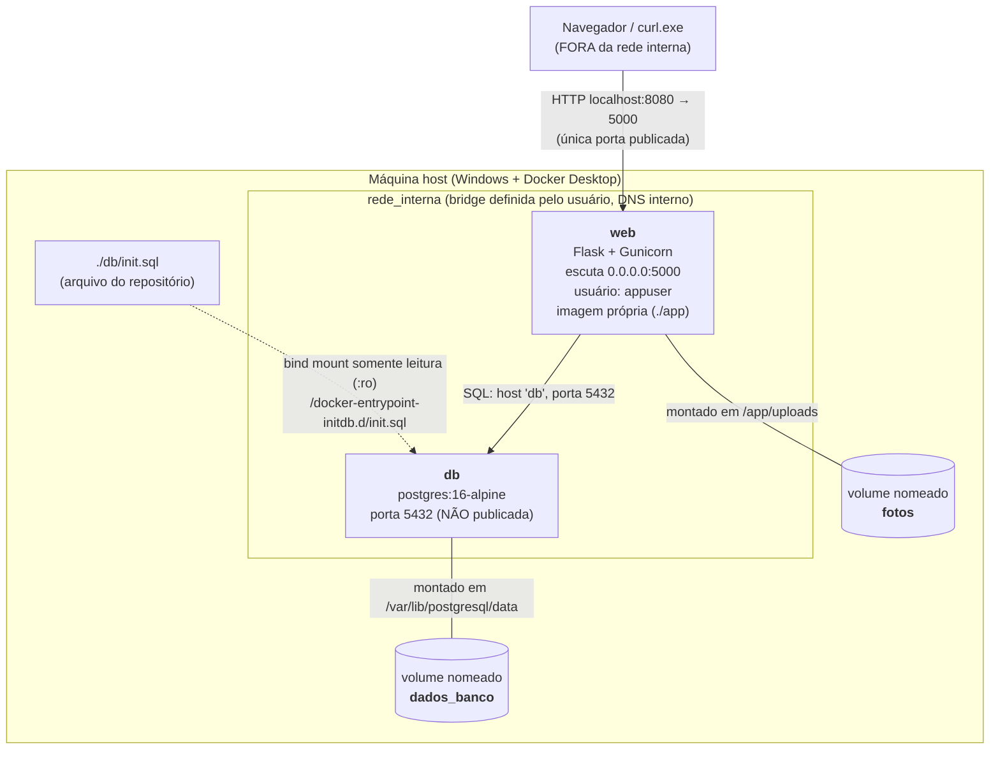

# Diagrama de arquitetura: Achados & Perdidos

## Legenda

| Elemento | Dentro da rede interna? | Observação |
|---|---|---|
| `web` | Sim | Publica 8080 (host) → 5000 (contêiner). Roda como `appuser` |
| `db` | Sim | Nenhuma porta publicada no host; só o `web` o alcança pelo nome `db` |
| Navegador / curl | Não | Só acessa a porta 8080 |
| Volume `fotos` | Fora (armazenamento) | Montado em `/app/uploads` no `web` |
| Volume `dados_banco` | Fora (armazenamento) | Montado em `/var/lib/postgresql/data` no `db` |
| `init.sql` | Fora | Bind mount `:ro` em `/docker-entrypoint-initdb.d/`; executa só na primeira execução (volume vazio) |

Os volumes sobrevivem a `docker compose down` e só são apagados com `docker compose down -v`.
A única seta que atravessa a fronteira da rede é a da porta 8080.